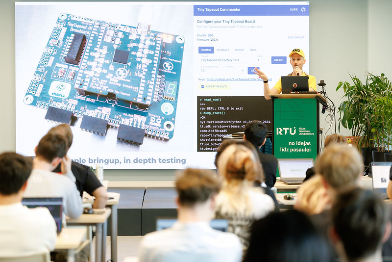
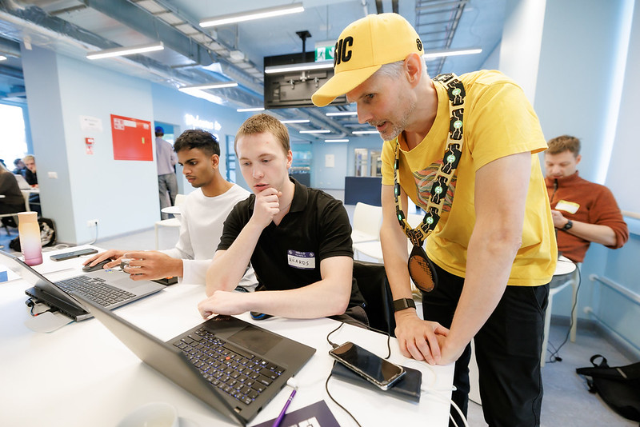
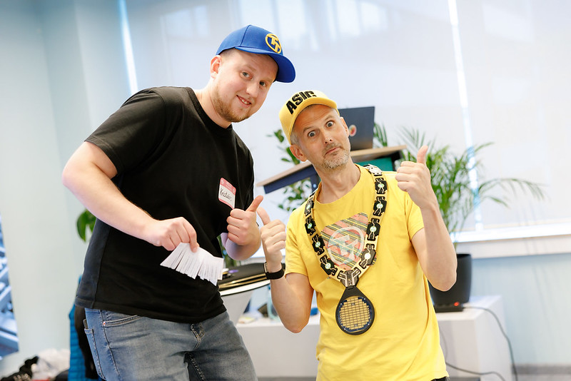
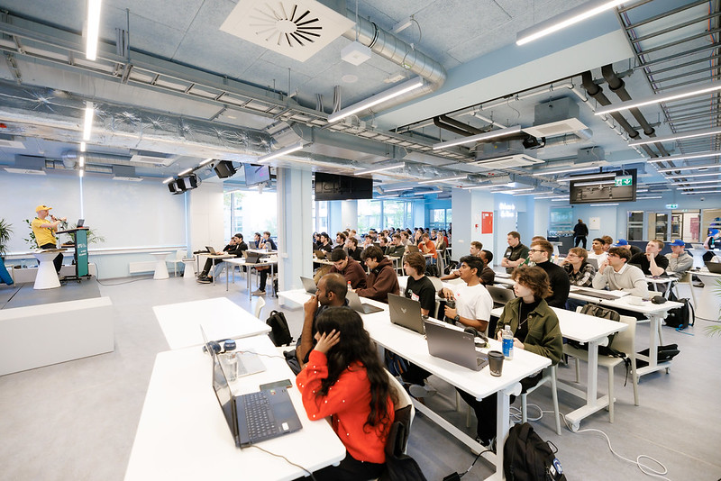
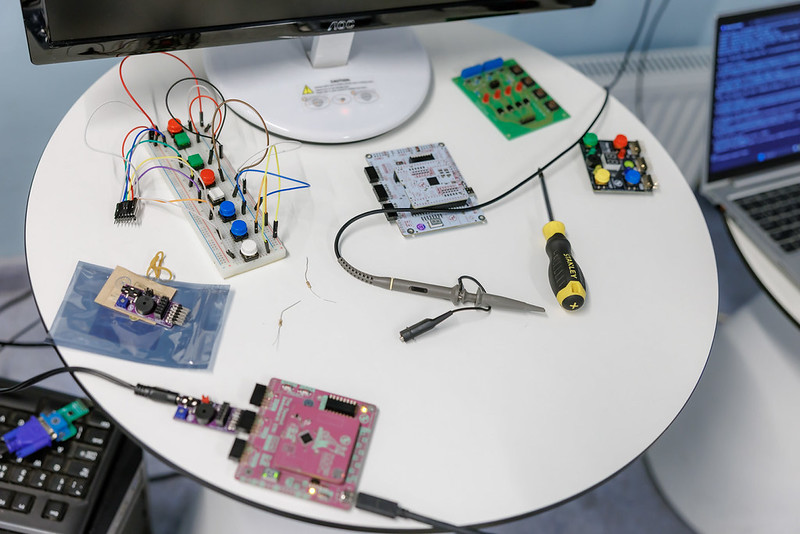
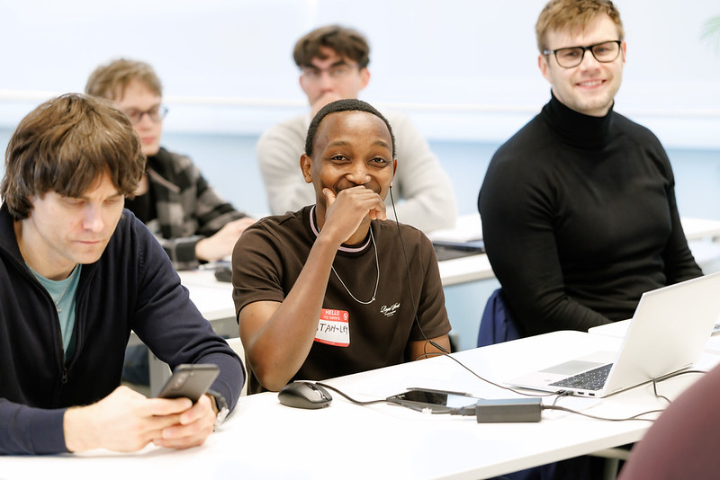
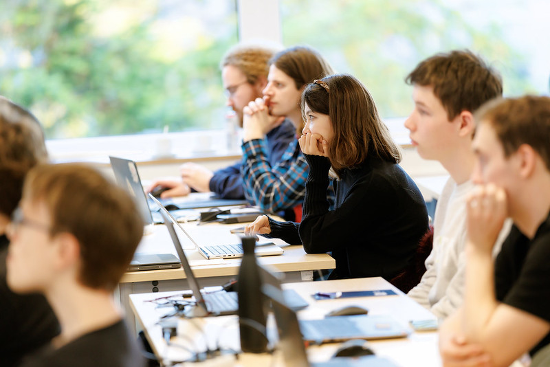
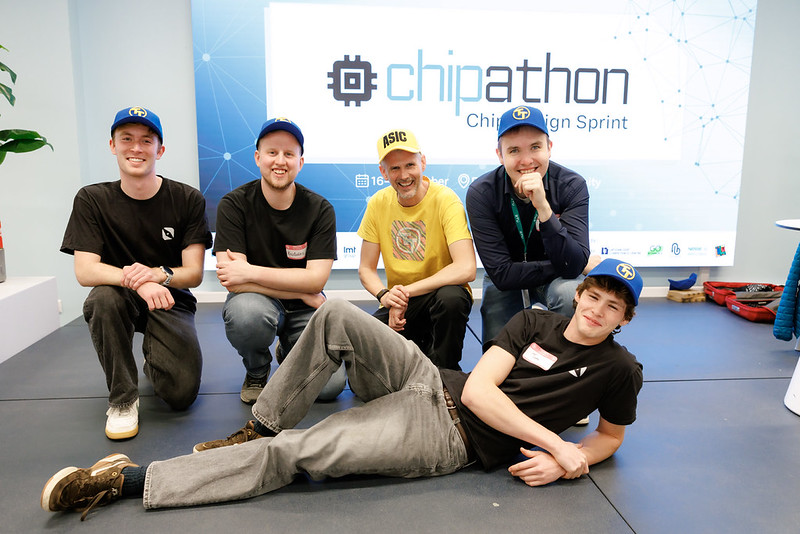
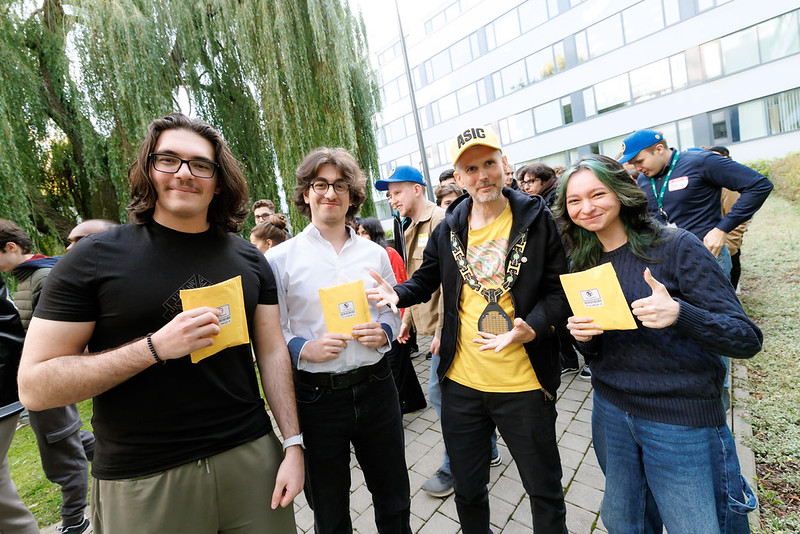

Tiny Tapeout was invited to run a workshop at Riga, Latvia, during the Chipathon 2026.

 [Chipathon](https://latvianccc.lv/2026/09/03/16-18-oktobri-rtu-notiks-chip-design-sprint-chipathon/) is a hands-on microchip and integrated circuit (IC) design event, which took place from October 16 to 18 at [Riga Technical University](https://www.rtu.lv/en). Ninety participants came ready to learn how a chip goes from idea to silicon.

  

    
    <button id="tt-prev" type="button" style="position:absolute; left:10px; top:50%; transform:translateY(-50%); width:56px; height:56px; margin:0; padding:0; font-size:40px; line-height:56px; text-align:center; color:#fff; background:rgba(0,0,0,0.6); border:none; border-radius:50%; cursor:pointer;">&#8249;</button>
    <button id="tt-next" type="button" style="position:absolute; right:10px; top:50%; transform:translateY(-50%); width:56px; height:56px; margin:0; padding:0; font-size:40px; line-height:56px; text-align:center; color:#fff; background:rgba(0,0,0,0.6); border:none; border-radius:50%; cursor:pointer;">&#8250;</button>
  

  <button id="tt-close" type="button" style="position:fixed; top:16px; right:20px; margin:0; padding:0; font-size:36px; line-height:1; color:#fff; background:none; border:none; cursor:pointer;">&times;</button>

The room had plenty of energy. Matt kept the tempo lively with his enthusiasm and musical talent.

> "I really enjoyed the songs, they were funny and had a lot of useful information in them."
> "I like the tempo and the approach Matt demonstrated. It's like you are enjoying the show + gaining new knowledges."

The workshop focused a lot around hands-on practice. Participants used [Wokwi](https://wokwi.com/) to build and test their designs in the browser, and [SiliWiz](https://app.siliwiz.com/) to work through transistor-level designs, including a CMOS inverter.

> "The wokwi was awesome! Got to learn new stuff in that site!!" 

> "the siliWiz propably the most exciting thing." Participants also said, "I liked that everthing has a tool ready and that they are easy to use."

The TAs were always there to give extra help, going deeper into the topics and answering the harder questions.

By the end of the workshop, participants had submitted 75 tapeouts. That means 75 designs that are now on their way to becoming real chips as part of the [TTSKY26d](https://app.tinytapeout.com/shuttles/ttsky26d) shuttle.

Thank you to everyone who joined us in Riga, and to the Riga Technical University for hosting!

 