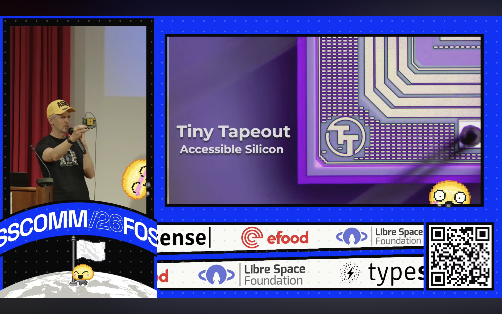

[FOSSCOMM](https://2026.fosscomm.gr/) is the annual physical summit for Greece's free and open-source ecosystem. 

The 19th edition of FOSSCOMM 2026 ran on October 31 to November 1, 2026, at the University of West Attica in Athens. It has run since 2008 as a free, volunteer-driven event, bringing together talks, workshops, and community booths.

There were many notable speakers this year, such as [Daniel Stenberg](https://daniel.haxx.se/), founder of [cURL](https://curl.se/), [Gaël Duval](https://gaelduval.com/), founder and CEO of [Murena](https://murena.com/) and creator of [Mandrake Linux](https://www.mandrakelinux.org/), and Maria Xynou, co-founder of [OONI](https://ooni.org/) and a member of the [Tor Project](https://www.torproject.org/)'s board.

 

Matt Venn was part of that roster. He gave a talk titled "Make Your First Chip with Open Source Tools and Tiny Tapeout."

As Matt explains, it all started in 2020, when the world's first open-source, manufacturable PDK (Process Design Kit) was released. Before that, a chip manufacturer's process technology was usually kept secret, and you typically had to sign an NDA just to access the documentation.

But with an open-source PDK, anyone could download the files, explore the technology, and learn how to design chips. Suddenly, making your own chip became a real possibility.

And that's how Tiny Tapeout began. 

Tiny Tapeout makes manufacturing even more accessible by bringing down the cost. Instead of manufacturing a separate chip for every design, multiple designs are combined onto a single chip. This means that each designer receives not only their own design, but also all the other designs sharing that chip.

Matt then blows people's minds by performing his rap number. 

 

Afterwards, he ran live demos of [SiliWiz](https://app.siliwiz.com/), GitHub Actions, the [3D viewer](https://gds-viewer.tinytapeout.com/), and showed different analog and digital designs. One of the largest projects was a community [competition](/competitions/demoscene-tt08-winners/) where Tiny Tapeout provided the RISC-V core and around 40 people submitted designs. The finished microcontroller had 60,000 standard cells, and all the winners received it. 

The talk ends with a Q&A. An audience member asked what layer of abstraction Tiny Tapeout works at, and what recipe the foundry provides, including whether designers work at the logic level or the transistor level, with the foundry deciding how each transistor is built.

Matt explained that the process design kit includes the layers of the chip, from the transistors at the bottom up through the metal layers. It also has the design rule checks (DRC), which set the thinnest and thickest transistors you're allowed to build. As long as you follow those rules, the factory will manufacture your design.

Watch the full talk [**here:**](https://youtu.be/TPDW_myjv7U?t=3094)

